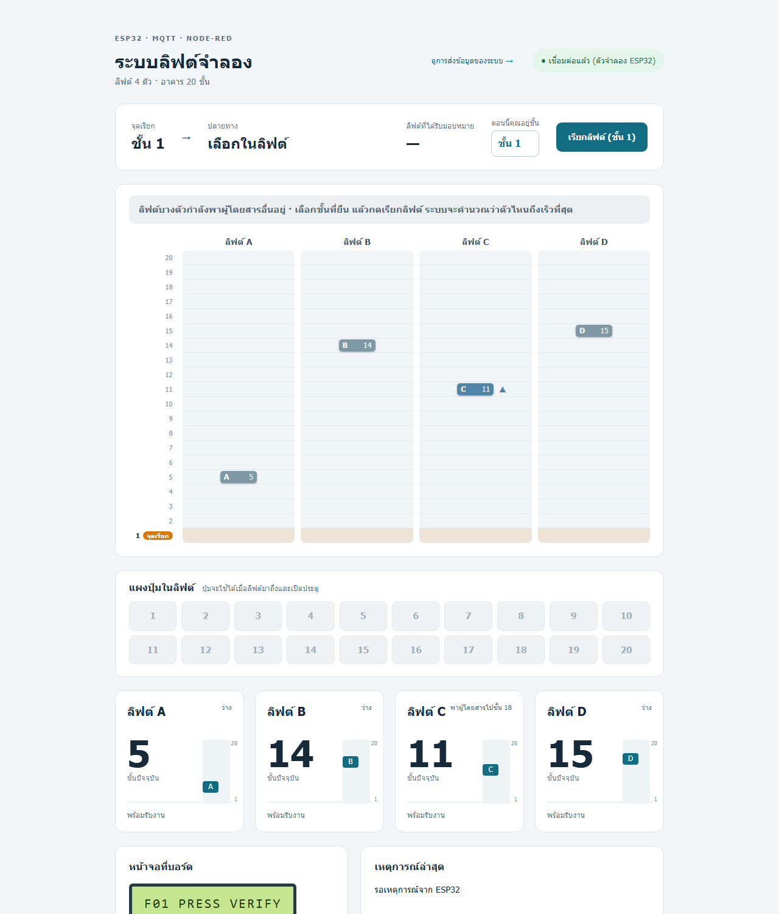
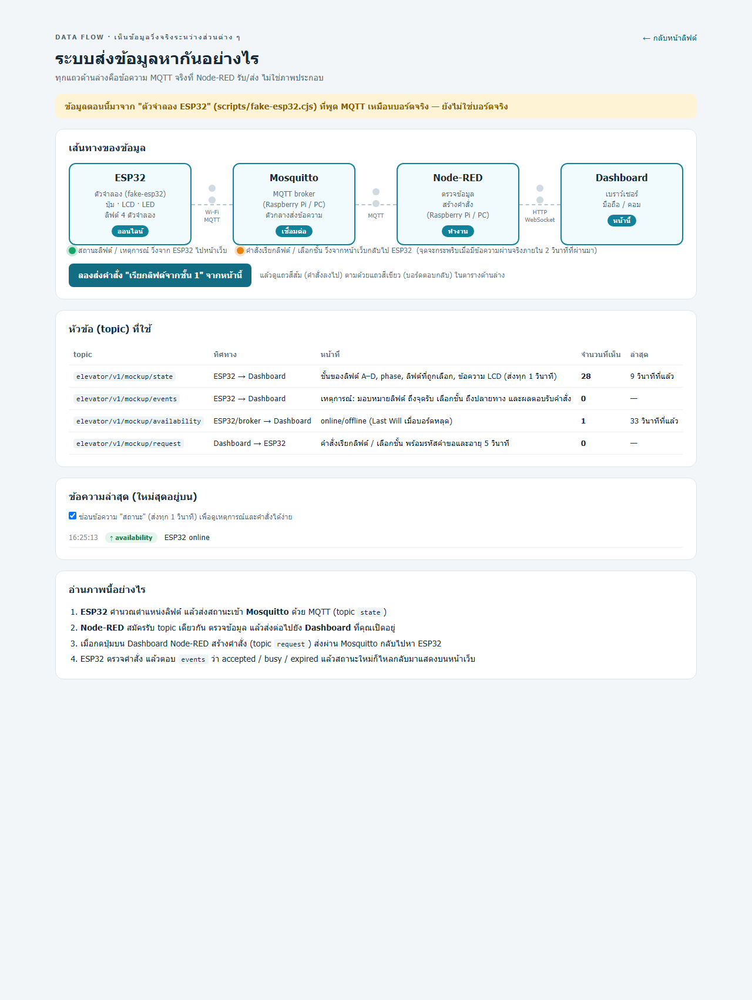

# Lift-LNW: แบบจำลองระบบลิฟต์ 4 ตัว (ESP32 + MQTT + Node-RED)

โครงงานวิชา CN360 จำลองลิฟต์ 4 ตัว (A–D) ในอาคาร 20 ชั้น ผู้ใช้เลือกว่ายืนอยู่ชั้นไหน กดเรียกลิฟต์ ระบบคำนวณว่าตัวไหนถึงเร็วที่สุด หน้าจอบอกให้ไปที่ลิฟต์ตัวนั้น เมื่อลิฟต์มาถึงให้กดเลือกชั้นปลายทาง แล้วลิฟต์พาไป ระหว่างนั้นลิฟต์ตัวอื่นวิ่งรับผู้โดยสารจำลองเองให้เหมือนมีคนใช้งานจริง

- เอกสารนำเสนอ (Canva): https://canva.link/j56zbzjounv3bp8
- โจทย์ข้อสอบจากอาจารย์ (แนบในโปรเจกต์): [overview/ข้อสอบ CN360 midterm 1 69.pdf](overview/ข้อสอบ%20CN360%20midterm%201%2069.pdf)

```text
ปุ่ม / LCD / LED  <->  ESP32 (ลิฟต์ 4 ตัวจำลอง)  <-- Wi-Fi / MQTT -->  Mosquitto (Raspberry Pi / PC)
                                                                            |
                                              Dashboard (มือถือ/คอม)  <->  Node-RED
```

## สถานะปัจจุบัน (ตามจริง)

| รายการ | สถานะ |
|---|---|
| ลอจิกลิฟต์ (จัดลิฟต์ตามเวลาที่ถึงเร็วสุด, ผู้โดยสารอื่นจำลอง, เลือกชั้น) | ทำแล้ว ผ่านเทสต์ C++ |
| เฟิร์มแวร์ ESP32 build ผ่าน (`pio run`) | ผ่าน แต่**ยังไม่ได้อัปโหลดและลองกับบอร์ดที่มีเฟิร์มแวร์เวอร์ชันนี้** |
| Mosquitto + Node-RED + Dashboard | Node-RED + Dashboard รันจริงบน Windows ได้ (ตอนทดสอบบนคอมใช้ broker ตัวจำลองแทน Mosquitto) |
| ทั้งสายบนคอม: ตัวจำลอง ESP32 -> MQTT -> Node-RED -> Dashboard | ทดสอบผ่านแล้ว (`scripts/test-live-select.cjs`) |
| ชุดติดตั้ง Raspberry Pi (`raspberry-pi/setup-pi.sh`) | เขียนแล้ว **ยังไม่ได้ทดสอบบน Pi จริง** (ตรวจ syntax เท่านั้น) |
| Wi-Fi ขาดช่วงที่เคยพบกับบอร์ดจริง | ยังไม่ได้แก้ |

## ข้อจำกัด: ยังไม่ครบตามโจทย์ข้อสอบ

โจทย์ของอาจารย์ (ไฟล์ PDF ด้านบน) เป็นระบบลิฟต์แตะบัตรแบบเลือกชั้นปลายทาง งานนี้เป็น **mockup ที่ทำเฉพาะบางส่วน** สิ่งที่ **ยังไม่ได้ทำ** คือ

- **RFID ยืนยันสิทธิ์การใช้ลิฟต์ยังไม่มี** ไม่มีเครื่องอ่านบัตร 13.56 MHz ไม่มีฐานข้อมูลสิทธิ์ว่าบัตรใดไปชั้นใดได้ ใครกดก็ไปได้ทุกชั้น
- **ลำดับการใช้งานต่างจากโจทย์** โจทย์ให้แตะบัตรและเลือกชั้นปลายทาง **ที่แผงหน้าลิฟต์ก่อน** แล้วระบบเลือกลิฟต์ (destination dispatch) งานนี้กดเรียกก่อน ระบบเลือกลิฟต์ แล้วเลือกชั้นในลิฟต์ (ผ่านแผงปุ่มบน Dashboard)
- **ไม่ได้ใช้ UART / RS-485** ตามโจทย์ ใช้ Wi-Fi + MQTT แทน จึงไม่มีการออกแบบเฟรม ที่อยู่โหนด broadcast และ CRC เอง
- **มี ESP32 เพียงบอร์ดเดียว** จำลองลิฟต์ทั้ง 4 ตัวและทุกชั้น โจทย์ต้องการแผงหน้าลิฟต์ 21 ชุด และหน่วยในลิฟต์ทุกตัว
- **ผู้ใช้จริงทีละคน** ลิฟต์ตัวอื่นขนผู้โดยสารจำลอง (สุ่ม) แต่ระบบรับคำขอจริงครั้งละหนึ่งงาน
- ไม่มีโหมดเพลิงไหม้ (ลิฟต์ทุกตัวกลับชั้น 1), ไม่มีการแสดง "ระบบขัดข้อง" ที่แผงหน้าลิฟต์ภายใน 3 วินาทีตามโจทย์ (Dashboard แค่ขึ้นสถานะข้อมูลไม่สด), ไม่มีเซนเซอร์ประตู น้ำหนัก ชุดขับมอเตอร์ หรือวงจรความปลอดภัย
- เวลาเดินทาง 2 วินาทีต่อชั้นตรงโจทย์ แต่เวลาจอดรับส่งตั้งไว้ต่างกัน (ปิดประตู 2 วินาทีหลังเลือกชั้น ผู้โดยสารจำลองจอด 4 วินาที) ปรับได้ใน `include/config.h`
- MQTT ใช้รหัสผ่านแต่ไม่มี TLS เหมาะกับเครือข่ายในห้องเท่านั้น

## ฟีเจอร์ที่ทำแล้ว

1. **เลือกชั้นที่ยืนอยู่** (1–20) แล้วกดเรียกลิฟต์ ปุ่มจริงบนบอร์ด (GPIO27) เรียกจากชั้นที่เลือกล่าสุด
2. **ผู้โดยสารจำลอง** ลิฟต์ที่ไม่ได้ใช้ออกวิ่งไปชั้นสุ่มทีละไม่เกิน 2 ตัว หยุดแล้วว่าง (ตัวที่ใช้กับผู้ใช้ไม่รับงานอื่น)
3. **จัดลิฟต์ตามเวลาที่ถึงเร็วสุด (ETA)** ลิฟต์ว่างนับตามระยะทาง ลิฟต์ที่กำลังส่งคนอื่นนับ "ส่งคนให้เสร็จ + จอด + มารับ" ถ้ามีเวลาเท่ากันเลือกตัวที่ได้งานน้อยกว่า Dashboard แสดงเวลาที่ประเมินของทุกตัว
4. **ลิฟต์ที่ถูกเลือกมารับ** LCD ขึ้น `GO TO LIFT C` ลิฟต์ที่กำลังส่งคนอื่นจะส่งให้เสร็จก่อน
5. **เลือกชั้นปลายทาง** เมื่อประตูเปิด (`LIFT C OPEN / SELECT FLOOR`) กดชั้นบนแผงปุ่ม ลิฟต์ปิดประตูแล้วพาไป ขึ้นหรือลงก็ได้ ไม่เลือกภายใน 30 วินาทีจะยกเลิก
6. **Dashboard** แผนผังตึก 20 ชั้นเคลื่อนไหว ลิฟต์ที่ผู้ใช้ใช้เป็นสีส้ม ลิฟต์อื่นที่พาผู้โดยสารเป็นสีน้ำเงิน มีลูกศรทิศทางและเส้นประไปเป้าหมาย
7. **หน้า Data Flow** (`/dashboard/dataflow`) แสดงว่าระบบส่งข้อมูลหากันจริง ดูหัวข้อด้านล่าง

### หน้าเว็บที่ใช้ดู





(ภาพจากการรันตัวจำลองบนคอม ไม่ใช่บอร์ดจริง)

| ที่อยู่ | แสดงอะไร |
|---|---|
| `http://127.0.0.1:1880/dashboard/elevators` | หน้าใช้งานหลัก: เรียกลิฟต์ เลือกชั้น แผนผังลิฟต์ |
| `http://127.0.0.1:1880/dashboard/dataflow` | **การส่งข้อมูลระหว่างระบบ**: ESP32 -> Mosquitto -> Node-RED -> Dashboard แสดงสถานะแต่ละช่วง จุดกระพริบเมื่อมีข้อความผ่านจริง ตารางหัวข้อ MQTT ที่ใช้พร้อมจำนวนข้อความ ล็อกข้อความจริงพร้อม JSON และปุ่มส่งคำสั่งทดสอบจากหน้านี้ จะบอกชัดว่าข้อมูลมาจาก **ตัวจำลอง** หรือ **บอร์ดจริง** |
| `windows/node-red/preview.html` | พรีวิวแบบไม่ต้องติดตั้งอะไร (ตัวจำลองในเบราว์เซอร์ ต้องมีอินเทอร์เน็ตเพื่อโหลด Vue) สร้างด้วย `node scripts/build-preview.cjs` เปิดผ่านเซิร์ฟเวอร์ใดก็ได้ เช่น `python -m http.server --directory windows/node-red` |

บนเครือข่ายจริง เปลี่ยน `127.0.0.1` เป็น IP ของเครื่องที่รัน Node-RED

## ติดตั้งเพื่อทดสอบบนคอม (ไม่ต้องมี ESP32 และ Raspberry Pi)

ต้องมี **Node.js 20 ขึ้นไป** (ทดสอบกับ 24) และอินเทอร์เน็ตสำหรับติดตั้งแพ็กเกจครั้งแรก ไม่ต้องใช้ Docker ไม่ต้องติดตั้ง Mosquitto

**Windows:** ดับเบิลคลิก `Start Local Simulation.cmd` (หรือรัน `powershell -File scripts\start-local-sim.ps1`) ครั้งแรกจะติดตั้งแพ็กเกจเอง สร้างรหัสผ่านสุ่มใน `windows/local-secrets.json` และเปิดเบราว์เซอร์ให้ ใช้ `-Speed 4` เพื่อให้ลิฟต์เร็วขึ้น 4 เท่า หยุดด้วย `scripts\stop-local-sim.ps1` บันทึกการทำงานอยู่ใน `windows/logs/`

**Linux / macOS:** รันด้วยมือ 3 ส่วน (จากโฟลเดอร์โปรเจกต์ คนละเทอร์มินัล)

```bash
npm ci --prefix windows/node-red
npm install --prefix windows/local-sim
node scripts/make-local-secrets.cjs
node scripts/generate-flows.cjs
node scripts/dev-broker.cjs                     # MQTT broker จำลอง (แทน Mosquitto)
node windows/node-red/node_modules/node-red/red.js --userDir windows/node-red --settings windows/node-red/settings.js
SPEED=1 node scripts/fake-esp32.cjs             # ตัวจำลอง ESP32 (พูด MQTT เหมือนบอร์ดจริง)
```

เปิด http://127.0.0.1:1880/dashboard/elevators ลองเลือกชั้นที่ยืน กด "เรียกลิฟต์" รอลิฟต์เปิดประตู แล้วกดชั้นปลายทาง และดู http://127.0.0.1:1880/dashboard/dataflow ประกอบ

ทดสอบอัตโนมัติ

```bash
node test/dashboard_test.cjs                    # ตรรกะ Node-RED (ตรวจข้อมูล คำสั่ง เลือกชั้น)
node scripts/test-live-select.cjs 16            # ทั้งสายผ่าน MQTT: เรียก -> ได้ลิฟต์ -> เลือกชั้น 16 -> ถึง
```

ลอจิกลิฟต์ฝั่ง C++ (`test/sim_test.cpp`) คอมไพล์ด้วยคอมไพเลอร์ C++17 ใดก็ได้ ใช้ `-I include` และไม่ต้องใช้ ESP32 เช่น `g++ -std=c++17 -I include test/sim_test.cpp -o sim_test && ./sim_test`

## ติดตั้งบน Raspberry Pi และบอร์ดจริง

> ชุดนี้ **ยังไม่ได้ทดสอบบน Pi จริง** ลองบนเครื่องสะอาดก่อนนำเสนอ

ไม่จำเป็นต้องใช้ Docker `setup-pi.sh` ติดตั้ง Mosquitto และ Node-RED ตรงบน Pi เป็นบริการที่เริ่มเองตอนเปิดเครื่อง

**ต้องมี:** Raspberry Pi (Raspberry Pi OS 64-bit), ESP32 DevKit (ESP32-WROOM-32), LCD 16x2 I2C (0x27), LED + ตัวต้านทาน 330 Ω, ปุ่มกด, Wi-Fi 2.4 GHz เดียวกันทั้ง Pi และ ESP32, คอมที่ติดตั้ง [PlatformIO](https://platformio.org/) สำหรับอัปโหลดเฟิร์มแวร์

**ต่อสาย ESP32**

| สัญญาณ | ขา ESP32 |
|---|---|
| LCD VCC / GND | 3V3 / GND |
| LCD SDA / SCL | GPIO21 / GPIO22 |
| LED | GPIO25 -> 330 Ω -> LED (+), LED (-) -> GND |
| ปุ่ม | GPIO27 -> ปุ่ม -> GND (ใช้ pull-up ภายใน) |

รูปวงจร: [docs/diagrams/03-simple-mockup-circuit.png](docs/diagrams/03-simple-mockup-circuit.png)

**ขั้นตอน**

1. คัดลอกโปรเจกต์ไป Pi แล้วรัน

   ```bash
   bash raspberry-pi/setup-pi.sh
   ```

   สคริปต์ติดตั้ง Mosquitto, Node.js 20+, Node-RED และสร้างบริการ `mosquitto` กับ `elevator-nodered` สุ่มรหัสผ่าน MQTT ใหม่ แล้วพิมพ์ค่า `mqttHost`, `mqttUser`, `mqttPassword` ออกมา (ในโหมด Pi หน้าแก้ flow ของ Node-RED ถูกปิดเพราะไม่มีรหัสผ่าน)
2. บนคอม คัดลอก `include/secrets.example.h` เป็น `include/secrets.h` ใส่ชื่อ/รหัส Wi-Fi และค่าจากข้อ 1
3. อัปโหลดเฟิร์มแวร์ `pio run --target upload` (เปิด Serial Monitor 115200 ควรเห็น `Wi-Fi connected` และ `MQTT connected`)
4. เปิด `http://<IP ของ Pi>:1880/dashboard/elevators` จากมือถือหรือคอมในเครือข่ายเดียวกัน และ `/dashboard/dataflow` เพื่อดูว่าบอร์ดส่งข้อมูลถึงจริง (ป้ายด้านบนต้องขึ้นว่า "บอร์ด ESP32 จริง")
5. ทดสอบทั้งสายกับบอร์ดจริง `MQTT_HOST=127.0.0.1 node scripts/test-live-select.cjs 16`

ตรวจบริการ: `systemctl status mosquitto elevator-nodered` ดูข้อความ MQTT สด: `mosquitto_sub -h localhost -u elevator -P '<รหัส>' -t 'elevator/v1/mockup/#' -v`

รายละเอียดเพิ่ม: [raspberry-pi/README_TH.md](raspberry-pi/README_TH.md)

## โครงสร้างโปรเจกต์

| ไฟล์/โฟลเดอร์ | หน้าที่ |
|---|---|
| `include/elevator_sim.h` | ลอจิกลิฟต์บนบอร์ด: ผู้โดยสารจำลอง, จัดลิฟต์ตาม ETA, เลือกชั้น |
| `include/config.h` | ขา GPIO ค่าเวลา และการตั้งผู้โดยสารจำลอง |
| `src/main.cpp`, `src/network.cpp` | ปุ่ม/LCD/LED และ MQTT (ทำงานคนละงาน FreeRTOS) |
| `scripts/lib/sim-core.cjs` | ลอจิกเดียวกันเป็น JavaScript ใช้โดยตัวจำลอง ESP32 และพรีวิว |
| `scripts/fake-esp32.cjs`, `scripts/dev-broker.cjs` | ตัวจำลองบอร์ดและ broker สำหรับทดสอบบนคอม |
| `windows/node-red/` | flow, หน้า Dashboard, หน้า Data Flow, ฟังก์ชันตรวจข้อมูล (สร้าง `flows.json` ด้วย `scripts/generate-flows.cjs`) |
| `raspberry-pi/` | สคริปต์ติดตั้งบน Pi |
| `test/` | เทสต์ลอจิกลิฟต์ (C++) และ Node-RED |
| `docs/` | เอกสารชุดส่งมอบเดิม (29 ต.ค.) บางส่วนล้าสมัย เช่น เส้นทางตายตัวชั้น 4->16 และการใช้ hotspot ของ Windows |

### MQTT (topic ขึ้นต้น `elevator/v1/mockup/`)

| topic | ทิศทาง | เนื้อหา |
|---|---|---|
| `state` (retained) | ESP32 -> Node-RED | ชั้นของ A–D, phase, ลิฟต์ที่เลือก, ชั้นเรียก/ปลายทาง, ปลายทางของลิฟต์ที่พาผู้โดยสารอื่น (`targets`), เวลาที่ประเมิน (`eta_s`), ข้อความ LCD |
| `events` | ESP32 -> Node-RED | มอบหมายลิฟต์ ถึงจุดรับ เลือกชั้น ถึงปลายทาง ผลตอบรับ (accepted/busy/expired) |
| `request` | Node-RED -> ESP32 | `{"action":"verify","floor":10,...}` เรียกลิฟต์จากชั้น 10 หรือ `{"action":"select","floor":16,...}` เลือกชั้น พร้อมรหัสคำขอ boot_id และอายุ 5 วินาที |
| `availability` (retained) | ESP32/broker -> Node-RED | `online` / `offline` (Last Will) |

## สิ่งที่อยากสานต่อ

1. **ใช้งานจำลองหลายผู้ใช้พร้อมกัน (multi-user)** รับคำเรียกหลายชั้นพร้อมกัน มีคิวและการรวมคำขอ (ลิฟต์ตัวเดียวรับหลายคนระหว่างทาง) ผู้ใช้แต่ละคนมีชั้นที่ยืนและปลายทางของตัวเอง แทนที่ผู้โดยสารจำลองแบบสุ่มด้วยผู้ใช้จริงหลายเครื่อง (เช่น หลายมือถือเปิด Dashboard พร้อมกัน)
2. **ยืนยันสิทธิ์การใช้ลิฟต์ด้วยบัตร** ลำดับที่คิดไว้
   - กดเรียกลิฟต์ แล้วเมื่อลิฟต์มาถึง ให้**แตะบัตร** (RFID 13.56 MHz เช่น MFRC522 ต่อ SPI กับ ESP32)
   - ระบบตรวจ UID กับฐานข้อมูลสิทธิ์ (บัตรใดไปชั้นใดได้ เก็บบน Raspberry Pi) แล้วให้เลือกชั้นได้เฉพาะชั้นที่มีสิทธิ์ ปุ่มชั้นที่ไม่มีสิทธิ์ถูกปิด
   - **ผู้ที่ไม่มีบัตรหรือบัตรไม่มีสิทธิ์** รอสักครู่ (หมดเวลาแตะบัตร) แล้วลิฟต์พาไปได้เฉพาะ**ชั้นที่ไม่ต้องใช้สิทธิ์** (เช่น ชั้น 1 ที่เป็นโถงทางเข้า และชั้นสาธารณะอื่น) เท่านั้น
   - จำกัดสิทธิ์รายชั้นและรายเวลา บันทึกประวัติการใช้งาน (audit log) และแสดงสาเหตุเมื่อปฏิเสธ
3. **ให้ตรงโจทย์ข้อสอบมากขึ้น** แตะบัตรและเลือกชั้นปลายทางที่แผงหน้าลิฟต์ก่อน (destination dispatch) แล้วระบบแสดงตัวอักษรลิฟต์ แยกแผงหน้าลิฟต์ต่อชั้น และหน่วยในลิฟต์เป็นไมโครคอนโทรลเลอร์ต่างหาก สื่อสารบน RS-485 ด้วยโปรโตคอลที่ออกแบบเอง (เฟรม CRC แอดเดรส broadcast timeout ส่งซ้ำ) แสดง "ระบบขัดข้อง" ภายใน 3 วินาที และโหมดเพลิงไหม้
4. แก้ปัญหา Wi-Fi ขาดช่วง ทดสอบความเสถียรระยะยาว และเพิ่ม TLS ให้ MQTT

## ที่มา

เริ่มจากชุดส่งมอบ 29 ตุลาคม 2026 (รุ่นใช้ Windows เป็นเครื่องแม่ข่ายและเส้นทางตายตัวชั้น 4 -> 16) แล้วพัฒนาต่อวันที่ 2 พฤศจิกายน 2026 ตามรายการด้านบน
