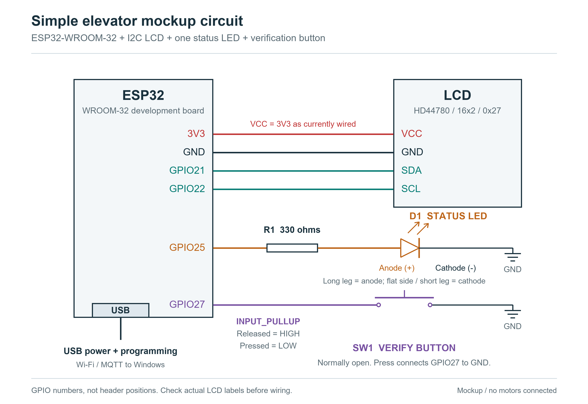
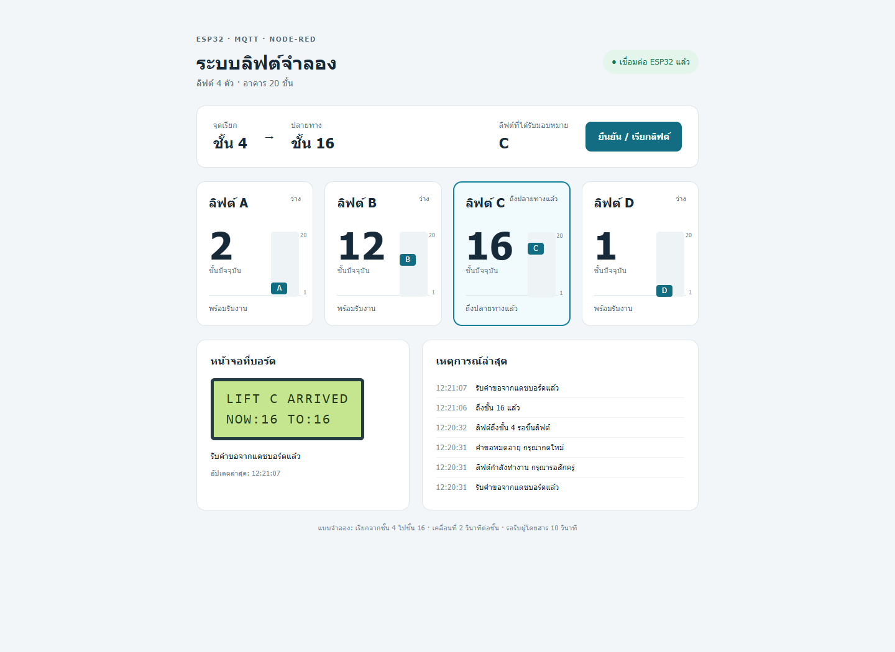

# คู่มือสำหรับทีมนำเสนอ: แบบจำลองลิฟต์ ESP32 + MQTT + Node-RED

> **หมายเหตุ (2 พ.ย. 2026):** เอกสารนี้เขียนก่อนอัปเดตล่าสุด ส่วนที่กล่าวถึงเส้นทางตายตัวชั้น 4→16, ปุ่มเรียกยืนยันชั้นเดียว และการใช้ Windows hotspot ถูกแทนที่แล้ว ดู [README.md](../README.md) สำหรับพฤติกรรมปัจจุบัน


วันที่จัดทำ: 29 ตุลาคม 2026  
ขอบเขตเอกสาร: mockup ปัจจุบันที่ใช้ **คอมพิวเตอร์ Windows** เป็นเครื่องแม่ข่าย ไม่ใช้ Raspberry Pi

> **สถานะที่ต้องบอกทีม:** ระบบหลักเคยทดสอบรับคำขอจากแดชบอร์ด เลือกลิฟต์ C รับที่ชั้น 4 และส่งถึงชั้น 16 ได้แล้ว แต่ยังพบ Wi-Fi ขาดช่วง ทำให้แดชบอร์ดหยุดอัปเดตเป็นบางครั้ง จึงยังไม่รับรองว่าพร้อมสาธิตได้อย่างเสถียรตลอดเวลา

## 1. โครงงานนี้ทำอะไร

เราสร้างแบบจำลองระบบเรียกลิฟต์ 4 ตัว ได้แก่ **A, B, C และ D** ภายในอาคารจำลอง 20 ชั้น โดยมี ESP32 เพียงหนึ่งบอร์ดจำลองตำแหน่งและการเคลื่อนที่ของลิฟต์ทั้งสี่ตัว

ผู้ใช้กดปุ่มเพื่อแทนการยืนยันตัวตน จากนั้น ESP32 เลือกลิฟต์ที่อยู่ใกล้จุดเรียก แสดงว่าลิฟต์ตัวไหนกำลังมาและอยู่ชั้นใดบน LCD พร้อมส่งข้อมูลผ่าน Wi-Fi/MQTT ไปแสดงบนแดชบอร์ด Node-RED ในคอมพิวเตอร์

เวอร์ชันนี้กำหนดจุดเรียกไว้ที่ **ชั้น 4** และปลายทางที่ **ชั้น 16** รับงานผู้โดยสารครั้งละหนึ่งงาน การเคลื่อนที่เป็นตัวเลขที่คำนวณในโปรแกรม ไม่มีมอเตอร์หรือห้องโดยสารจริง

## 2. อุปกรณ์และหน้าที่

| ส่วนประกอบ | หน้าที่ใน mockup |
|---|---|
| ESP32-WROOM-32 / ESP32 Dev Module | อ่านปุ่ม เลือกลิฟต์ จำลองชั้นปัจจุบัน ควบคุม LCD/LED และรับส่ง MQTT |
| LCD 16×2 แบบ HD44780 + I2C backpack ที่ 0x27 | แสดงตัวอักษรลิฟต์ ชั้นปัจจุบัน จุดรับ และปลายทาง จอจริงเป็น LCD ตัวอักษร ไม่ใช่ OLED |
| LED 1 ดวง + ตัวต้านทาน 330 Ω | แสดงสถานะของลิฟต์ที่ได้รับมอบหมาย ไม่ได้มี LED แยกสี่ตัว |
| ปุ่มกด 1 ปุ่ม | จำลองการยืนยันตัวตนและส่งคำขอเดินทาง ไม่ได้ตรวจบัตรหรือฐานข้อมูลผู้ใช้จริง |
| Windows + Mosquitto | เป็นตัวกลางรับและกระจายข้อความ MQTT |
| Windows + Node-RED และ FlowFuse Dashboard | ประมวลผลข้อความที่ได้รับ แสดงลิฟต์ A–D และสร้างปุ่มเรียกลิฟต์ผ่านหน้าเว็บ |
| PlatformIO / Arduino framework | ใช้เขียน คอมไพล์ และอัปโหลดเฟิร์มแวร์ ESP32 โดยเลือกบอร์ด `esp32dev` |

### การต่อสายที่ใช้อยู่

| สัญญาณ | ต่อกับ ESP32 |
|---|---|
| LCD VCC / GND | 3V3 / GND |
| LCD SDA / SCL | GPIO21 / GPIO22 |
| LED | GPIO25 → ตัวต้านทาน 330 Ω → ขา anode (+), ขา cathode (−) → GND |
| ปุ่มยืนยัน | GPIO27 → ปุ่มกดแบบปกติเปิด → GND |
| ไฟเลี้ยงและอัปโหลดโปรแกรม | สาย USB ของ ESP32 |

ปุ่มใช้ `INPUT_PULLUP`: ปล่อยปุ่มอ่าน HIGH และกดปุ่มอ่าน LOW มีการกรองการเด้งของหน้าสัมผัส 35 ms เพื่อให้การกดหนึ่งครั้งเกิดคำขอเดียว



LCD ปัจจุบันต่อกับ 3V3 ตามวงจรทดลอง หากโมดูลต้องใช้ 5 V ต้องใช้วงจรแปลงระดับ I2C ที่เหมาะสมด้วย เพราะตัวต้านทาน pull-up บน backpack อาจดึง SDA/SCL ขึ้นไป 5 V ซึ่งไม่เหมาะกับ GPIO ของ ESP32 การทดสอบอ่านเขียนหน่วยความจำจอผ่านไม่ได้ยืนยันว่าตัวอักษรบนจอจริงอ่านชัดเสมอ

## 3. ภาพรวมระบบ และเราใช้ MQTT กับ Node-RED ตรงไหน

```text
ปุ่มกด ──> ESP32 ──> LCD และ LED
              │
              │ ข้อมูลชั้น/สถานะของ A–D ส่งด้วย MQTT ผ่าน Wi-Fi
              ▼
       Mosquitto บน Windows
              │
              │ กระจายข้อความให้ผู้ติดตามหัวข้อนั้น
              ▼
        Node-RED บน Windows ──> แดชบอร์ดในเว็บเบราว์เซอร์
              │
              │ เมื่อกดปุ่มเรียกบนแดชบอร์ด
              └── MQTT request ──> Mosquitto ──> ESP32
```

**ผู้ตัดสินใจเลือกลิฟต์และคำนวณการเคลื่อนที่คือ ESP32** ส่วน Node-RED แสดงข้อมูลและส่งคำขอเรียกจากระยะไกล ในเวอร์ชันนี้ Mosquitto และ Node-RED ไม่ได้คำนวณเลือกตัวลิฟต์แทน ESP32

### MQTT ใช้ตรงไหน

MQTT คือวิธีส่งข้อความระหว่าง ESP32 กับโปรแกรมฝั่ง Windows ผ่านเครือข่าย โดยใช้รูปแบบ **publish/subscribe**: ผู้ส่งประกาศข้อความไว้ในหัวข้อหรือ **topic** และผู้รับติดตามหัวข้อที่ต้องการ

ในงานนี้ใช้ MQTT สองทิศทางหลัก:

1. **ESP32 → Windows:** ส่งชั้นปัจจุบันของ A–D ลิฟต์ที่ได้รับมอบหมาย ช่วงการเดินทาง ข้อความ LCD และเหตุการณ์ต่าง ๆ เพื่อให้หน้าเว็บแสดงข้อมูลจากบอร์ดจริง
2. **Windows → ESP32:** เมื่อกดปุ่ม “ยืนยัน / เรียกลิฟต์” บนแดชบอร์ด Node-RED ส่งคำขอผ่าน MQTT ให้ ESP32 ใช้ขั้นตอนเรียกลิฟต์เดียวกับปุ่มจริง

ESP32 ไม่ได้ส่งข้อมูลตรงเข้าเว็บเบราว์เซอร์ แต่ส่งเข้า **Mosquitto** ซึ่งเป็น **MQTT broker** หรือตัวกลางกระจายข้อความ ส่วน MQTT เป็นรูปแบบการสื่อสาร ไม่ใช่ชื่อแดชบอร์ด

### Node-RED ใช้ตรงไหน

Node-RED ทำงานอยู่บน Windows และมี flow ทำหน้าที่ดังนี้:

| งานของ Node-RED | ทำอย่างไร |
|---|---|
| รับข้อมูลบอร์ด | MQTT In ติดตาม topic ของ mockup ผ่าน Mosquitto |
| ตรวจข้อความ | Function ตรวจรูปแบบ JSON ชื่อลิฟต์ ชั้น และข้อมูลสถานะก่อนนำไปใช้ |
| สร้างหน้าแสดงผล | FlowFuse Dashboard แสดงการ์ด A–D ไฮไลต์ลิฟต์ที่เลือก แสดงชั้น ข้อความ LCD และเหตุการณ์ล่าสุด |
| ตรวจข้อมูลขาดช่วง | ตรวจข้อมูลสดและสถานะ broker เพื่อเปลี่ยนหน้าเว็บเป็นรอการเชื่อมต่อ/ข้อมูลเก่า |
| รับปุ่มจากหน้าเว็บ | Function สร้างรหัสคำขอและข้อมูลอายุคำขอ แล้ว MQTT Out ส่งกลับไปที่ ESP32 |

flow หลักใน Node-RED จึงอ่านได้ว่า:

```text
MQTT In → ตรวจข้อมูลและสถานะออนไลน์ → Dashboard
Dashboard button → สร้างคำขอที่มีรหัสเฉพาะ → MQTT Out → ESP32
```

FlowFuse Dashboard เป็นส่วนเสริมที่สร้างหน้าเว็บใน Node-RED การดูหน้าเว็บใช้ HTTP/การเชื่อมต่อของแดชบอร์ด ส่วนข้อความระหว่างบอร์ดกับ broker ใช้ MQTT

### Topic ที่ใช้จริง

ทุกหัวข้อมีส่วนต้นเป็น `elevator/v1/mockup/`

| Topic | ผู้ส่ง → ผู้รับ | ใช้ทำอะไร | เก็บข้อความล่าสุดที่ broker หรือไม่ |
|---|---|---|---|
| `elevator/v1/mockup/state` | ESP32 → Node-RED | ชั้นของ A–D, ลิฟต์ที่เลือก, phase, ชั้นเรียก/ปลายทาง และข้อความ LCD | เก็บ (`retained`) |
| `elevator/v1/mockup/events` | ESP32 → Node-RED | มอบหมายลิฟต์ ถึงจุดรับ ถึงปลายทาง และผลตอบรับคำขอ | ไม่เก็บ |
| `elevator/v1/mockup/request` | Node-RED → ESP32 | คำขอยืนยัน/เรียกลิฟต์จากหน้าเว็บ | ไม่เก็บ |
| `elevator/v1/mockup/availability` | ESP32 / broker → Node-RED | `online` เมื่อเชื่อมต่อ และ `offline` จาก Last Will เมื่อ broker ตรวจพบการหลุด | เก็บ |

ESP32 ส่ง `state` เมื่อมีการเปลี่ยนแปลง และส่งซ้ำเป็นระยะประมาณทุก 1 วินาทีเมื่อเครือข่ายปกติ ตัวอย่าง JSON ต่อไปนี้เป็น **ตัวอย่างเพื่ออธิบายรูปแบบ**:

```json
{
  "boot_id": "0123456789abcdef",
  "uptime_ms": 12000,
  "phase": "coming",
  "assigned": "C",
  "hall_floor": 4,
  "destination": 16,
  "floors": {"A": 2, "B": 12, "C": 3, "D": 1},
  "lcd": ["LIFT C COMING", "NOW:03 HALL:04"]
}
```

`assigned` บอกว่าผู้โดยสารควรใช้ลิฟต์ตัวไหน ส่วน `floors` บอกชั้นของทุกตัว `boot_id` เปลี่ยนเมื่อบอร์ดเริ่มใหม่ และ `uptime_ms` เป็นเวลาตั้งแต่บอร์ดเริ่มทำงาน

### ถ้ากดปุ่มจริง MQTT ทำงานตอนไหน

ปุ่มจริงต่อเข้า GPIO ของ ESP32 โดยตรง ESP32 รับปุ่มและเลือกลิฟต์ได้เอง จากนั้นจึง publish ผลการเลือกและตำแหน่งออกไปให้ Node-RED แสดง **การกดปุ่มจริงไม่ได้ต้องรอ Node-RED ส่งคำอนุมัติกลับมา**

ถ้ากดปุ่มบนหน้าเว็บ เส้นทางจะกลับกัน: Node-RED publish `request` → Mosquitto กระจายให้ ESP32 → ESP32 ตรวจและรับงาน → publish `state` และผลตอบรับกลับมา

## 4. ESP32 เลือกลิฟต์อย่างไร

ตำแหน่งเริ่มต้นหลังรีเซ็ตบอร์ดคือ:

| ลิฟต์ | ชั้นเริ่มต้น | ระยะห่างจากชั้นเรียก 4 |
|---|---:|---:|
| A | 2 | 2 ชั้น |
| B | 12 | 8 ชั้น |
| C | 3 | 1 ชั้น |
| D | 1 | 3 ชั้น |

จึงเลือก **C** ในคำขอแรก เพราะอยู่ใกล้ชั้น 4 ที่สุด ถ้าระยะทางเท่ากัน จะเลือกตัวที่เคยได้รับมอบหมายน้อยกว่า และถ้ายังเท่ากันจะเลือกตามลำดับ A → B → C → D

หลังเดินทาง ลิฟต์คงตำแหน่งปลายทางไว้ ไม่กลับไปจุดเริ่มต้นโดยอัตโนมัติ ผู้โดยสารคำขอใหม่ยังเริ่มจากชั้น 4 เสมอ หากกดเรียกต่อเนื่องหลังงานก่อนจบ ลำดับสี่งานแรกจากการรีเซ็ตปกติคือ **C → A → D → B**

แบบจำลองนี้รับงานครั้งละหนึ่งงาน จึงมีเพียงตัวที่ถูกเลือกเคลื่อนที่ในช่วงนั้น ส่วนอีกสามตัวอยู่ชั้นเดิม ยังไม่ใช่ระบบที่ลิฟต์สี่ตัวรับงานคนละชุดพร้อมกัน

## 5. ลำดับการเดินทางและสิ่งที่เห็น

| Phase ในโค้ด | ความหมาย | ตัวอย่าง LCD | LED |
|---|---|---|---|
| `idle` | รอคำขอใหม่ | `F04 PRESS VERIFY` / `A02 B12 C03 D01` | ดับ |
| `coming` | ตัวที่เลือกกำลังมารับที่ชั้น 4 | `LIFT C COMING` / `NOW:03 HALL:04` | กะพริบ |
| `boarding` | ถึงชั้น 4 รอผู้โดยสารขึ้น 10 วินาที | `LIFT C AT HALL` / `NOW:04 TO:16` | ติดค้าง |
| `riding` | กำลังไปชั้น 16 | `LIFT C MOVING UP` / `NOW:05 TO:16` | กะพริบ |
| `arrived` | ถึงชั้น 16 แสดงผล 10 วินาทีก่อนกลับหน้ารอ | `LIFT C ARRIVED` / `NOW:16 TO:16` | ติดค้าง |

`NOW` คือชั้นปัจจุบันของลิฟต์ที่ได้รับมอบหมาย, `HALL` คือจุดรับ และ `TO` คือปลายทาง ส่วนการแสดง A–D บนหน้ารอเป็นภาพรวมชั้นของลิฟต์ทั้งสี่ตัว

ความเร็วจำลองคือ 2 วินาทีต่อชั้น งานแรกของ C จึงใช้เวลาตามค่าที่ตั้งไว้ประมาณ:

```text
ชั้น 3 → ชั้น 4       2 วินาที
รอรับผู้โดยสาร      10 วินาที
ชั้น 4 → ชั้น 16     24 วินาที
รวมถึงปลายทาง      36 วินาที
แสดงผลเมื่อถึงอีก   10 วินาที แล้วกลับหน้ารอ
```

เวลาเหล่านี้เป็นค่าจำลอง ไม่ใช่การรับประกันเวลาบนแดชบอร์ดเมื่อเครือข่ายขาดช่วง ผู้ใช้ส่งงานใหม่ได้เมื่ออยู่ `idle` หรือ `arrived` ส่วนการกดระหว่างรับหรือส่งผู้โดยสารจะไม่เพิ่มคิวงาน

## 6. การกันคำขอซ้ำและการขาดการเชื่อมต่อ

- กดปุ่มจริงค้างไว้เกิดคำขอเดียว ต้องปล่อยและกดใหม่ หากกดค้างขณะเปิดบอร์ดต้องปล่อยก่อน
- ปุ่มหน้าเว็บส่งคำขอแบบไม่ retained และมี `request_id` เฉพาะ เพื่อแยกการกดแต่ละครั้ง
- ESP32 จำรหัสคำขอในหน่วยความจำแบบวงรอบ 32 รายการ เพื่อไม่เริ่มงานซ้ำจากการส่งข้อความเดิมซ้ำ
- คำขอต้องตรงกับ `boot_id` ปัจจุบัน และอายุจากเวลาบอร์ดต้องไม่เกิน 5 วินาที จึงลดโอกาสรับคำขอเก่าหลังรีเซ็ตหรือเครือข่ายล่าช้า
- ผลตอบกลับคือ `accepted` (รับงาน), `busy` (กำลังทำงาน) หรือ `expired` (คำขอเก่า/หมดอายุ)
- Node-RED ตรวจทุก 1 วินาที ถ้าไม่มีข้อมูลสดเกินเกณฑ์ 3.5 วินาที หรือ broker/บอร์ดแจ้งหลุด จะเปลี่ยนเป็นสถานะข้อมูลไม่สดและไม่เปิดให้กดเรียกจากเว็บ
- ค่า `state` ที่ broker เก็บไว้เป็นเพียงข้อมูลล่าสุดในอดีต ไม่ใช่หลักฐานว่าบอร์ดยังออนไลน์ ต้องรอข้อความสดด้วย

ESP32 แยกงานเครือข่ายออกจากงานจำลองด้วย FreeRTOS task และ queue ดังนั้นช่วงที่ส่ง MQTT ไม่สำเร็จ ปุ่ม LCD LED และการเดินทางในบอร์ดยังทำงานต่อได้ อย่างไรก็ตาม การเชื่อมต่อกลับและความต่อเนื่องของแดชบอร์ดยังมีปัญหาที่ต้องแก้ต่อ เหตุการณ์ระหว่างหลุดไม่ได้เก็บไว้ส่งย้อนหลังทั้งหมด

ตำแหน่งลิฟต์อยู่ใน RAM ของ ESP32 และกลับค่าเริ่มต้นเมื่อรีเซ็ต ประวัติเหตุการณ์หน้าเว็บเป็นข้อมูลในหน่วยความจำของ Node-RED ยังไม่มีฐานข้อมูลถาวร

## 7. วิธีสาธิตบนเครื่องที่ตั้งค่าไว้แล้ว

1. ต่อ ESP32 เข้ากับ USB เพื่อจ่ายไฟ พร้อม LCD ปุ่ม และ LED ตามวงจรเดิม
2. ให้ Windows เชื่อม Wi-Fi แล้วเปิด `Start Mockup.cmd` ในโฟลเดอร์งานเดิม สคริปต์เปิดฮอตสปอต `Elevator-Mockup` และเริ่ม Mosquitto กับ Node-RED
3. เปิด **http://127.0.0.1:1880/dashboard/elevators** รอจนสถานะเป็นเชื่อมต่อ ESP32 และเห็นชั้นครบ A–D
4. หากต้องการสาธิตงานแรกเป็น C ให้รีเซ็ต ESP32 รอข้อมูลสด แล้วตรวจ A=2, B=12, C=3, D=1 ก่อนกด
5. กดปุ่มจริงหนึ่งครั้ง อธิบายว่าปุ่มแทนการยืนยันตัวตน และ C ใกล้ชั้น 4 ที่สุด
6. ชี้ LCD กับการ์ด C บนแดชบอร์ด: กำลังมารับ → ถึงชั้น 4 รอ 10 วินาที → เดินทางขึ้นทีละชั้น → ถึงชั้น 16
7. เมื่องานจบ กดปุ่มบนแดชบอร์ดเพื่อแสดงเส้นทางคำขอผ่าน Node-RED → MQTT → ESP32 งานถัดไปอาจเลือก A ตามตำแหน่งที่เหลือ
8. ถ้าเห็นข้อมูลไม่สด ให้อธิบายตามจริงว่า Wi-Fi ขาดช่วง อย่าตีความตำแหน่งเก่าบนเว็บว่าเป็นตำแหน่งปัจจุบัน

หน้าสำหรับแก้ flow คือ **http://127.0.0.1:1880** ส่วนพอร์ต MQTT คือ **1883** ภายในเครือข่ายท้องถิ่น ปัจจุบัน ESP32 เชื่อมฮอตสปอตของคอมและใช้ที่อยู่ broker `192.168.137.1`

`127.0.0.1` หมายถึงเครื่องที่เปิดเบราว์เซอร์อยู่ การส่ง URL นี้ให้ทีมไม่ได้ทำให้ทีมเห็นแดชบอร์ดจากเครื่องอื่น และ ZIP ชุดนี้ไม่ได้สร้างเว็บไซต์ออนไลน์ให้โดยอัตโนมัติ

### ถ้าสาธิตสดไม่ต่อเนื่อง

ตรวจว่าฮอตสปอตยังเปิด คอมไม่หลับ และ ESP32 ยังมีไฟ ใช้ภาพใน `docs/images/dashboard-live.png` ประกอบการอธิบายแทนได้ โดยบอกว่าเป็น **ภาพจากการทดสอบก่อนหน้า** ไม่ใช่ข้อมูลสดขณะนำเสนอ ภาพมีเหตุการณ์ busy/expired เพราะมีการทดสอบคำขอที่ไม่ควรรับด้วย



## 8. บทพูดตัวอย่างประมาณ 2–3 นาที

“โครงงานนี้เป็นแบบจำลองระบบเรียกลิฟต์สี่ตัว A ถึง D ในอาคารยี่สิบชั้น เราใช้ ESP32 หนึ่งบอร์ดจำลองการเคลื่อนที่ ใช้ปุ่มแทนการสแกนบัตร ใช้ LCD แสดงลิฟต์ที่ได้รับมอบหมายและชั้นปัจจุบัน และใช้ LED บอกว่ากำลังเคลื่อนที่หรือจอดอยู่

เมื่อผู้ใช้กดปุ่ม ESP32 จะเลือกลิฟต์ที่อยู่ใกล้จุดเรียกชั้นสี่ที่สุด เช่น ตอนเริ่มต้น C อยู่ชั้นสามจึงถูกเลือก จากนั้น C มารับ รอสิบวินาที และพาผู้โดยสารไปชั้นสิบหก โดยจำลองการเดินทางชั้นละสองวินาที

เราใช้ MQTT เพื่อส่งสถานะจาก ESP32 ผ่าน Wi-Fi ไปที่ Mosquitto บน Windows ซึ่งเป็นตัวกลางกระจายข้อความ ส่วน Node-RED ติดตามข้อความเหล่านี้ ตรวจข้อมูล และสร้างแดชบอร์ดที่แสดงชั้นของลิฟต์ทั้งสี่ตัว รวมถึงลิฟต์ที่กำลังมารับ

อีกทิศทางหนึ่งคือกดเรียกจากแดชบอร์ด Node-RED จะสร้างคำขอและส่งผ่าน MQTT กลับไปที่ ESP32 โดย ESP32 ยังเป็นผู้เลือกและควบคุมแบบจำลองเหมือนเดิม

ส่วนหลักทดสอบได้แล้ว รวมถึงการรับงานและเดินทางถึงปลายทาง แต่ยังพบ Wi-Fi ขาดช่วง จึงแสดงสถานะข้อมูลเก่าและระงับการเรียกจากเว็บเมื่อข้อมูลไม่สด งานนี้ยังเป็น mockup ที่รับงานทีละงาน ไม่มีมอเตอร์ เครื่องอ่านบัตร หรือระบบความปลอดภัยของลิฟต์จริง”

## 9. คำถามที่ทีมควรตอบได้

| คำถาม | คำตอบตามระบบปัจจุบัน |
|---|---|
| ใช้ MQTT ตรงไหน | ส่งสถานะ/เหตุการณ์จาก ESP32 ไป Windows และส่งคำขอจากแดชบอร์ดกลับ ESP32 ผ่าน Mosquitto |
| ใช้ Node-RED ตรงไหน | รับ MQTT ตรวจข้อมูล สร้างแดชบอร์ด ตรวจข้อมูลไม่สด และส่งคำขอจากปุ่มหน้าเว็บ |
| Mosquitto กับ Node-RED ต่างกันอย่างไร | Mosquitto กระจายข้อความ MQTT ส่วน Node-RED ใช้ข้อความเหล่านั้นสร้างขั้นตอนทำงานและหน้าจอ |
| ใครเลือกลิฟต์ | ESP32 เลือกตามระยะทาง จำนวนครั้งที่เคยได้รับงาน และลำดับตัวอักษร |
| มี ESP32 สี่ตัวหรือไม่ | มีหนึ่งตัว จำลองสถานะของลิฟต์สี่ตัวในโปรแกรม |
| ปุ่มตรวจสิทธิ์ผู้ใช้จริงหรือไม่ | ไม่ตรวจ เป็นการสมมติว่ากดยืนยันแล้วผ่าน ยังไม่มี RFID หรือฐานข้อมูลสิทธิ์ |
| เลือกชั้นปลายทางเองได้หรือยัง | ยังไม่ได้ รุ่นนี้กำหนดชั้น 4 ไป 16 ไว้ตายตัว |
| Wi-Fi หลุดแล้วลิฟต์หยุดหรือไม่ | แบบจำลองใน ESP32 เดินต่อได้ แต่หน้าเว็บอาจแสดงข้อมูลล่าสุดที่เก่าแล้ว |
| ระบบใช้ Raspberry Pi หรือไม่ | รุ่นปัจจุบันใช้ Windows เป็นเครื่องแม่ข่ายและไม่ต้องใช้ Pi |
| จำเป็นต้องมีอินเทอร์เน็ตเพื่อใช้ MQTT หรือไม่ | MQTT ในระบบนี้ส่งในเครือข่ายท้องถิ่น แต่การติดตั้งแพ็กเกจและข้อกำหนดการเปิดฮอตสปอตของ Windows เป็นอีกเรื่องหนึ่ง |
| ระบบพร้อมนำไปควบคุมลิฟต์จริงหรือไม่ | ยังไม่พร้อม ไม่มีมอเตอร์ วงจรนิรภัย การรับรอง หรือระบบควบคุมลิฟต์จริง |

## 10. สิ่งที่ทำได้แล้วและสิ่งที่ยังไม่ครบ

| รายการ | สถานะที่ควรนำเสนอ |
|---|---|
| โค้ด PlatformIO และอัปโหลด ESP32 | ทำแล้ว |
| แบบจำลอง A–D และการเลือกตัวใกล้จุดเรียก | มีในโค้ด และมี host tests |
| Mosquitto + Node-RED บน Windows | ติดตั้งและเชื่อมต่อกันแล้ว |
| ส่งสถานะจริงจากบอร์ดไปแดชบอร์ด / เรียกจากเว็บ | เคยทดสอบสำเร็จ |
| งาน C รับชั้น 4 และไปถึงชั้น 16 | เคยทดสอบสำเร็จ |
| กันคำขอซ้ำ busy/expired และตรวจข้อมูลเก่า | มีการทดสอบ แต่ไม่ได้หมายความว่าผ่านความเสถียรเครือข่ายระยะยาว |
| ความต่อเนื่องของ Wi-Fi และแดชบอร์ด | **ยังมีปัญหา ต้องแก้และทดสอบซ้ำ** การตั้งให้เลือก 2.4 GHz ก่อนยังไม่ใช่หลักฐานว่าแก้หายทั้งหมด |
| จอ LCD อ่านชัดบนอุปกรณ์จริง | ต้องตรวจด้วยตาอีกครั้ง เคยมีอาการอักษรเพี้ยน และการทดสอบหน่วยความจำผ่านไม่ยืนยันความชัดของจอ |
| RFID / ฐานข้อมูลสิทธิ์ / เลือกปลายทางอิสระ | ยังไม่ได้ทำ ใช้ปุ่มและเส้นทางคงที่แทน |
| งานผู้โดยสารหลายงานพร้อมกัน / โหลดเกิน / โหมดไฟไหม้ / วงจรนิรภัย | ยังไม่อยู่ใน mockup นี้ |

เอกสารโจทย์ต้นฉบับในโฟลเดอร์ `overview/` เป็นข้อกำหนดที่กว้างกว่า mockup นี้ อย่านำรายละเอียดในโจทย์มาอ้างว่าระบบปัจจุบันทำครบแล้ว

## 11. ถ้าทีมต้องการอ่านโค้ด ควรเริ่มจากไฟล์ไหน

| ไฟล์ | เนื้อหาที่ควรดู |
|---|---|
| `include/config.h` | ขา GPIO จุดเรียก ปลายทาง และเวลาต่าง ๆ |
| `include/elevator_sim.h` | ตำแหน่งลิฟต์ อัลกอริทึมเลือกตัว และ phase การเดินทาง |
| `src/main.cpp` | อ่านปุ่ม คุม LCD/LED และเชื่อมขั้นตอนจำลองกับเครือข่าย |
| `src/network.cpp` | **จุดที่ ESP32 ใช้ MQTT**: เชื่อม broker, publish state/events, subscribe request และ Last Will |
| `windows/node-red/flows.json` | **flow ของ Node-RED**: MQTT In, Function, Dashboard และ MQTT Out |
| `windows/node-red/monitor-function.js` | ตรวจ state สถานะออนไลน์ และเหตุการณ์ |
| `windows/node-red/request-function.js` | สร้างคำขอจากหน้าเว็บพร้อมรหัสและอายุคำขอ |
| `windows/node-red/dashboard.html` | หน้าตาและการแสดงผลแดชบอร์ด |
| `scripts/start-mockup.ps1` | เปิดฮอตสปอตและโปรแกรมฝั่ง Windows |
| `docs/HANDOFF_CONTENTS_TH.md` | รายการใน ZIP และแนวทางเตรียมเครื่องใหม่ |

## 12. ประเด็นสำคัญสำหรับจำไปพูด

**ESP32 คิดและจำลองลิฟต์ → MQTT ส่งข้อความผ่าน Mosquitto → Node-RED ตรวจและแสดงข้อมูล → ปุ่มบนแดชบอร์ดส่งคำขอ MQTT กลับ ESP32**

ควรนำเสนอว่า “สื่อสารและสาธิตการทำงานหลักได้แล้ว แต่ยังต้องแก้ความเสถียร Wi-Fi” เพื่อให้ตรงกับผลทดสอบจริง
