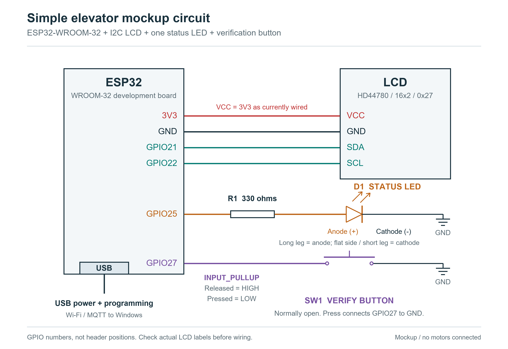

# Current prototype: simple elevator mockup

> **หมายเหตุ (2 พ.ย. 2026):** เอกสารนี้เขียนก่อนอัปเดตล่าสุด ส่วนที่กล่าวถึงเส้นทางตายตัวชั้น 4→16, ปุ่มเรียกยืนยันชั้นเดียว และการใช้ Windows hotspot ถูกแทนที่แล้ว ดู [README.md](../README.md) สำหรับพฤติกรรมปัจจุบัน


Updated 2026-10-29. The current hardware is one ESP32-WROOM-32 development board, a confirmed 16x2 HD44780 character LCD with a 0x27 I2C backpack, one indicator LED, and one normally-open verification pushbutton. Add a 330 ohm series resistor for the LED. This supersedes the earlier hall-panel shopping list and the original assumption that the display was a pixel OLED. Windows now hosts Mosquitto and Node-RED; Raspberry Pi is not used.



## Wiring

| Component | Connection |
| --- | --- |
| LCD VCC | ESP32 3V3 |
| LCD GND | ESP32 GND |
| LCD SDA | ESP32 GPIO21 |
| LCD SCL | ESP32 GPIO22 |
| Status LED | GPIO25 -> 330 ohm resistor -> LED anode (+); LED cathode (-) -> GND |
| Verification button | GPIO27 -> normally-open switch -> GND |
| ESP32 power and programming | USB connector |

Use the labels on the LCD board; the physical pin order varies. The driver is hd44780_I2Cexp, configured for 16 columns and 2 rows at 0x27. VCC is currently connected to 3V3. If characters remain invisible after adjusting the backpack contrast screw, check the module's rated voltage: some LCDs need 5 V for readable contrast even though the I2C backpack responds at 3.3 V. Use a suitable bidirectional I2C level shifter for a 5 V backpack instead of exposing ESP32 SDA/SCL to 5 V pull-ups. The diagram shows the current test wiring, not guaranteed 3.3 V compatibility of every 1602 module.

Configure the button as `INPUT_PULLUP`. It reads HIGH when released and LOW when pressed; no external button resistor is required. Detect one debounced falling edge per press so holding the button does not repeatedly request trips. On common four-leg tactile switches, two pins are permanently joined on each side: use contacts from opposite electrical sides, confirmed with a continuity check.

Use an ordinary low-current red or green indicator LED with its series resistor. Configure GPIO25 as OUTPUT, initially LOW. Long leg is normally anode (+); flat edge and short leg normally identify cathode (-).

## Demo behavior

1. LCD shows `F04 PRESS VERIFY` and `A02 B12 C03 D01`. LED off.
2. Press the button to simulate a verified passenger at floor 4 requesting floor 16.
3. Select the nearest of four simulated cars. Show `LIFT C COMING` and `NOW:03 HALL:04`, for example.
4. Show pickup and wait 10 seconds for boarding, then show the car letter, its current floor, and destination throughout the trip. LED blinks during movement.
5. Show arrival at floor 16 with the LED on for 10 seconds, then return to the four-car overview. Each car retains its floor for future assignments.

One LED represents the selected car's status. Four cars A-D are implemented in the standalone firmware, initially idle and available. One passenger request is active at a time.

## Windows, MQTT and Node-RED

The four-car simulation runs on ESP32 and publishes state through Wi-Fi/MQTT to Mosquitto on Windows. Node-RED receives this state for its dashboard and sends remote verification requests through the same firmware handler as the physical button. This communication has been implemented and exercised on the connected board. Wi-Fi intermittency remains unresolved, so the successful journey test is not a claim of continuous network reliability. See [the Windows instructions](windows-mockup.md) and [the Thai presentation guide](TEAM_PRESENTATION_GUIDE_TH.md).

There is no computer-to-ESP32 signal wiring beyond USB power/programming. MQTT uses the computer's private Wi-Fi hotspot. The original serial-bus and RFID requirements remain part of the examination brief, but this simplified prototype substitutes a button and Wi-Fi/MQTT. No motors or safety hardware are connected.

## PlatformIO pin settings

```cpp
constexpr int LCD_SDA = 21;
constexpr int LCD_SCL = 22;
constexpr int STATUS_LED = 25;
constexpr int VERIFY_BUTTON = 27;

// In setup():
Wire.begin(LCD_SDA, LCD_SCL);
digitalWrite(STATUS_LED, LOW);
pinMode(STATUS_LED, OUTPUT);
pinMode(VERIFY_BUTTON, INPUT_PULLUP);
```

The PlatformIO firmware is in `src/main.cpp`, the simulation in `include/elevator_sim.h`, and MQTT in `src/network.cpp`, with settings in `include/config.h`. It assigns each new floor-4-to-16 request to the nearest car. Earlier upload, initialization and LCD memory tests passed after LCD timing adjustments. Visible readability requires checking the actual panel. See the root README for diagnostics and build instructions.
